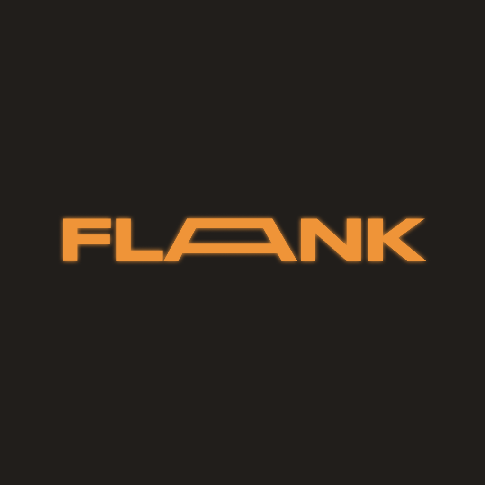

# Flank

<p align="center">
  
</p>

<p align="center">
  Your ultimate companion for Valorant esports coverage, delivering live matches, rankings, and news in a beautifully crafted SwiftUI experience.
</p>

<p align="center">
  
  
  
</p>

## Features

- 🎮 **Live Matches**: Stay updated with ongoing professional Valorant matches
- 🏆 **Global Rankings**: Track your favorite teams' standings in real-time
- 📰 **Latest News**: Keep up with the latest developments in the Valorant esports scene
- 🌙 **Dark Mode Support**: Comfortable viewing experience day and night
- 📱 **Native iOS Experience**: Built with SwiftUI for smooth performance

## Repository layout

| Path | What it is |
|------|------------|
| `ios/` | The SwiftUI app. Open `ios/Flank.xcodeproj`. |
| `api/` | The VLR.gg data service the app talks to (a fork of [axsddlr/vlrggapi](https://github.com/axsddlr/vlrggapi), MIT). FastAPI, managed with `uv`, deployed to Vercel with `api` as the project root. |
| `.github/workflows/api-*.yml` | CI for the API. These run only when `api/**` (or the workflow itself) changes. |

Working on the API:

```sh
cd api
uv sync
uv run pytest -q
uv run python main.py   # serves on http://127.0.0.1:3001
```

Point a Debug build of the app at the local server with the launch argument
`-FLANKAPIHost http://127.0.0.1:3001`.

Upstream politeness settings (environment variables on the API deployment):

| Variable | Default | Effect |
|----------|---------|--------|
| `VLR_USER_AGENT` | a desktop Chrome string | User-Agent sent to vlr.gg. Set it to something identifiable (bot name + contact) so vlr.gg can allowlist or contact us instead of blocking. |
| `VLR_MAX_CONCURRENCY` | `6` | Requests to vlr.gg in flight at once, per instance. |
| `VLR_MIN_REQUEST_INTERVAL` | `0.1` | Minimum seconds between request starts, per instance. |

A 403/429 from vlr.gg is never retried: it pauses all requests to vlr.gg for the instance (Retry-After, or 60 s doubling to 15 min), and the API serves the last good payload (up to 6 h old) in the meantime.

`api/` was squashed in from [Chefski/vlrggapi](https://github.com/Chefski/vlrggapi),
which keeps its earlier history. Because this repo doesn't share that history,
upstream fixes are applied as a diff from the last synced upstream commit:

```sh
# Last synced axsddlr/vlrggapi commit; update it after each sync.
LAST_SYNC=1cb73ceb8123c89e586a3862eaf544021294dd10

git fetch https://github.com/axsddlr/vlrggapi.git master
git diff "$LAST_SYNC" FETCH_HEAD -- . ':!.github' | git apply --3way --directory=api
git rev-parse FETCH_HEAD   # new LAST_SYNC
```

Upstream workflow changes (`.github/`) are left out; port any you want to the
`api-*.yml` workflows by hand.

`api/WORKFLOW.md` and the API README describe the API's earlier single-branch
(`master`) setup; in this repo the API follows the same `dev`/`main` flow as the app.

## Development and releases

- `dev` is the default branch and the integration point for ongoing work.
- `main` is the release branch: Xcode Cloud builds the app from it, and the API's production deploy and Docker image come from it.
- To create a new build, update `dev`, then fast-forward `main` to `origin/dev` and push `main`:

  ```sh
  git fetch origin
  git switch main
  git merge --ff-only origin/dev
  git push origin main
  git switch dev
  ```

Keeping release-only changes out of `main` ensures every Xcode Cloud build corresponds to a tested `dev` commit.

## Screenshots

<p align="center">
  
  
  
  
  
</p>

## Credits

Flank relies on the following amazing resources:

- [VLR.gg](https://vlr.gg) - The premier source for Valorant esports coverage, news, and match data
- [Flank VLR API](https://flank-vlr-api.vercel.app/) - The v2 and v3 APIs in `api/` powering Flank's VLR.gg data, built on [vlrggapi](https://github.com/axsddlr/vlrggapi) by Andre Saddler
